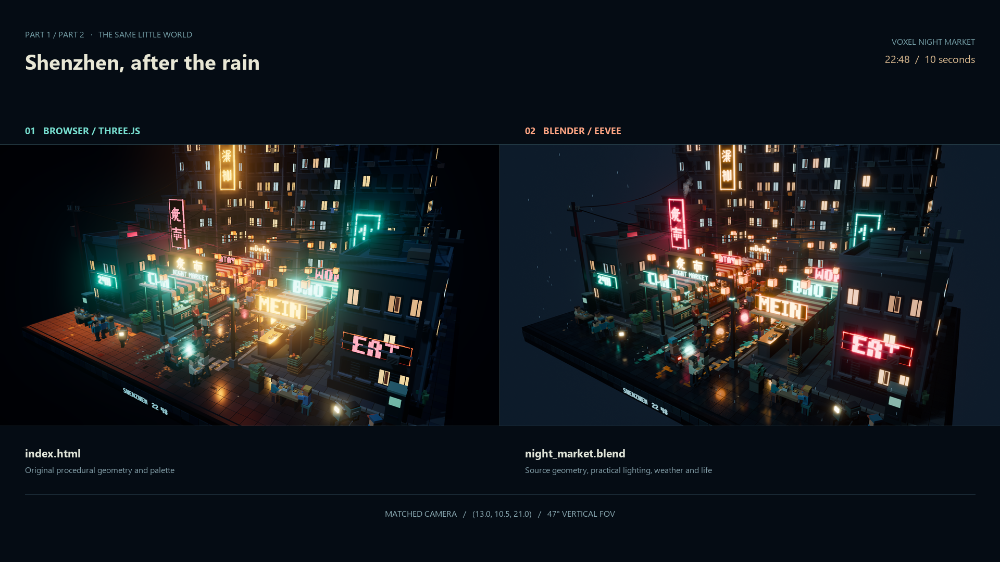

# Kimi K3.1 Pro vs GPT-6 Astra — game, voxel diorama, Blender, channel intro

Two models, the same prompts, each in its own native agent: **Kimi K3.1 Pro** in Kimi Code (effort max, official Kimi API) and **GPT-6 Astra** in Codex (ChatGPT subscription; effort xhigh, max in the race). No hints from me: each model writes, runs and checks its own work.

**▶ Play in your browser:** https://kostikoneuro.github.io/kimi-vs-astra/
**🎬 Video (Russian):** [YOUTUBE LINK]
**💬 Telegram:** https://t.me/kostik_neuro

## The tests

| # | Test | Astra | Kimi |
|---|---|---|---|
| 1 | **Neon Night Racer** — 80s arcade racer in the browser | [play](1-race/astra/) | [play](1-race/kimi/) |
| 2a | **Night market voxel diorama** — Three.js, 30-second fly-through, `C` = free camera | [open](2a-diorama/astra/) | [open](2a-diorama/kimi/) |
| 2b | **The same diorama in Blender** — sent as the next message: rebuild *your own* diorama as an animated Blender scene and render 10 s | [video](2b-blender/astra/flythrough.mp4) · [.blend](2b-blender/astra/night_market.blend) | [video](2b-blender/kimi/flythrough.mp4) · [.blend](2b-blender/kimi/night_market.blend) |
| 3 | **Channel intro** — 10 s, made autonomously in [OpenMontage](https://github.com/calesthio/OpenMontage), $1 budget for paid generation | [v1](3-intro/astra/v1.mp4) · [v2](3-intro/astra/v2.mp4) · [v3](3-intro/astra/v3.mp4) | [v1](3-intro/kimi/v1.mp4) · [v2](3-intro/kimi/v2.mp4) · [v3](3-intro/kimi/v3.mp4) |

Intro versions: **v1** — made without paid generation (the kie.ai balance was empty, I forgot to top it up); **v2** — after top-up, both models chose to add only music; **v3** — I asked for generated images (Kimi added backgrounds, Astra re-made the key, chips and glasses).

The exact prompts are in [`prompts/`](prompts/).

## Time and cost

Official list prices per 1M tokens: Kimi K3.1 Pro $2 in / $0.20 cached / $10 out; GPT-6 Astra $10 in / $1 cached / $50 out. Token counts are taken from the session logs.

| Test | Astra | Kimi |
|---|---|---|
| 1 Race | 27 min · $4.42 | 30 min · $1.10 |
| 2a Diorama | ~40 min · ~$9 * | 39 min · $1.31 |
| 2b Blender | ~60 min · ~$15 * | 90 + 18 extra min · $8.51 |
| 3 Intro v1 | 81 min · ~$26 ** | 90 + 8 extra min · $9.99 |
| **Total** | **~$54** | **~$21** |

\* Astra's 2a and 2b were run by a friend of the channel (Skyline) on his account; there are no logs, so the cost is an estimate from my own Astra runs.
\** After the 17th minute this run continued through a third-party gateway with poor prompt caching (it measured $61); ~$26 is the same token count with normal OpenAI caching, which is what Astra costs when used directly.

## How it was run

- One prompt per test, identical for both models. A test gets 90 minutes. Kimi got extra time twice (Blender 2b: 18 min to finish the last frames; intro: 8 min after the video was already rendered), and this is said in the video.
- Kimi Code CLI 2.3.2 in a clean home folder, `kimi-k3.1-pro`, effort max. Codex for Astra in a clean `CODEX_HOME` (no personal instructions or design skills — an earlier run showed they bias the result).
- Kimi's diorama session crashed after the file was finished (the Kimi API answered "429 engine overloaded" ten times in a row), so 2b ran as a new session that read the diorama from `index.html`, as the prompt asks.
- Both models made tiny compatibility edits to the OpenMontage framework (one schema field each, one test list).

## Credits

Thanks to **Skyline** for running Astra's diorama and Blender tests when my subscription ran out.

This video was made in partnership with **Kimi**. All scores and opinions are my own.
